# 排隊怪獸｜iPhone 17 手機版實際操作與畫面截圖

測試日期：2026-11-10（台灣時間）；正式站點：<https://hub-google.github.io/LINE/booking/>。使用 GitHub Actions Chromium 模擬 iPhone 17：**402×874 CSS px，DPR 3，觸控，iPhone Safari UA**。請注意：這不是實體 iPhone / Safari，沒有安裝 LINE App，也沒有登入真實帳號。測試僅瀏覽、展開選單、輸入搜尋字詞與查看畫面，未建立預約或取號。

### 驗證結果

- **整頁沒有水平跑版**：各路由的 document width 均為 402px。
- **搜尋店家結果看不到**：搜尋頁第一張結果卡片容器從 y=892px 才開始，超過首屏 y=874px；搜尋輸入框從 y=609px 才出現，首頁上半段過度佔空間。
- **顧客流程被 LINE 登入中斷**：預約與取號入口約 2 秒先呈現「資料更新中」，延長至約 12 秒，兩條路徑都跳到 LINE 官方登入頁並顯示「無法登入」。這是沒有 LINE App 的 Chromium 模擬情境，不能直接斷言實體 iPhone 一定故障；但已確認未能在一般模擬手機瀏覽器中完成流程。需另驗證在 Safari、LINE 內建瀏覽器、有/無 LINE App 的情況。
- **「我的預約」未登入顯示「0 個店家 / 還沒有找到你的預約紀錄」**：沒登入的狀態不該和已登入但無紀錄混在一起。
- **首頁手機選單有兩條相同目的的看板入口**：「公開叫號看板」與「查看公開叫號看板」。
- **商家操作指南的導覽項目橫向藏在螢幕外**：第 4–8 個選單項目延伸至 x=763px，雖未撐寬整頁，但需要滑動才看得到；沒有清楚可橫滑提示。
- **操作區偏小**：LINE 登入按鈕約高 37px、公開叫號看板底部兩按鈕高 36px、店家登入頁頂端文字連結高 19px，低於建議的 44px 觸控範圍。
- **測試門市名稱仍公開顯示**：熱門店家出現「專屬測試門市」「青禾風格美髮（測試門市）」，公開看板也顯示「（測試門市）」。
- **商家申請入口難找**：品牌首頁手機選單和主要 CTA 未提供「店家註冊」；必須知道店家專區網址或從其他頁面進入。

### 真實畫面（點圖可看原始解析度）

<table>
<tr><td align="center"><b>1. 品牌首頁</b> 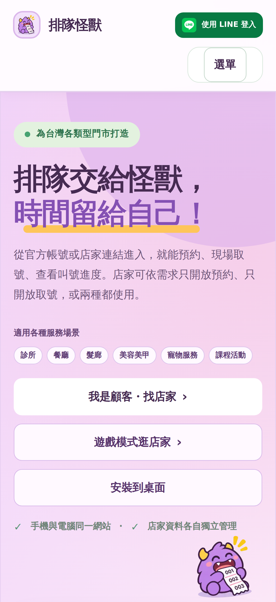</td><td align="center"><b>2. 手機選單（重複入口）</b> 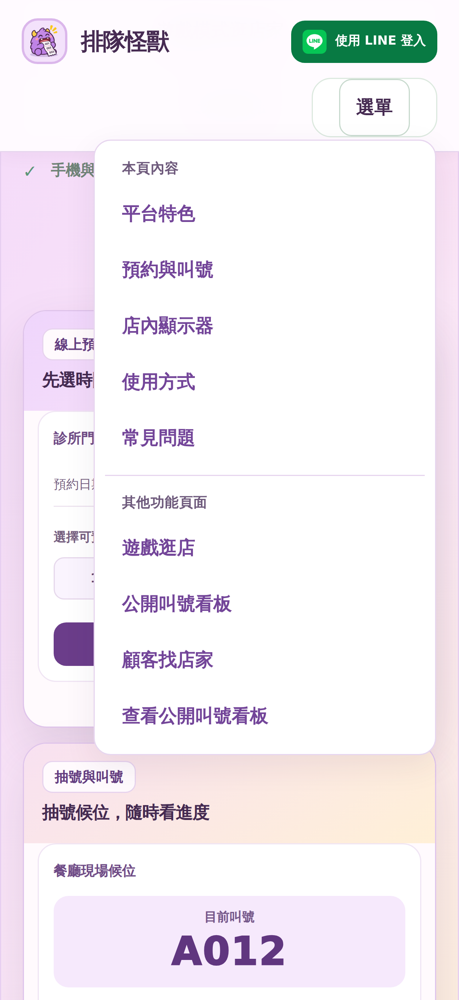</td></tr>
<tr><td align="center"><b>3. 店家搜尋（首屏看不到店家）</b> 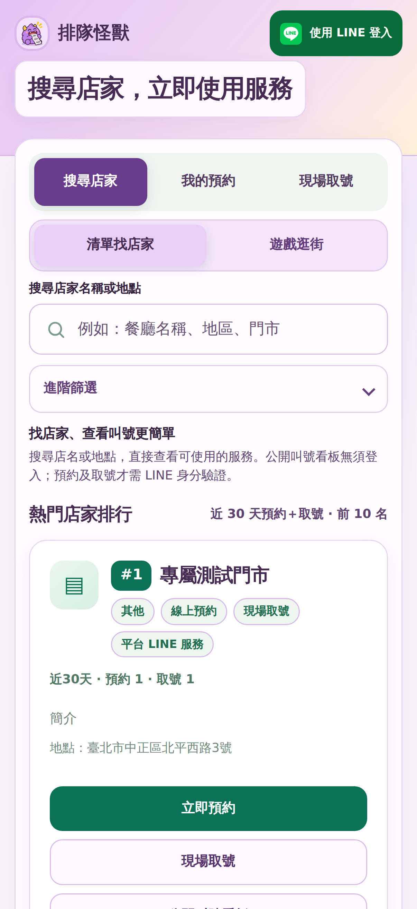</td><td align="center"><b>4. 往下滑後才看到店家</b> 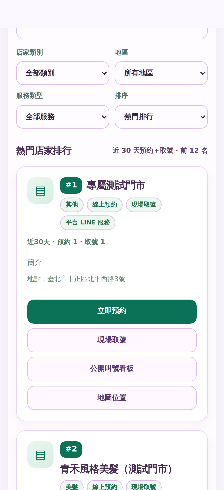</td></tr>
<tr><td align="center"><b>5. 搜尋「診所」回傳 0 筆</b> 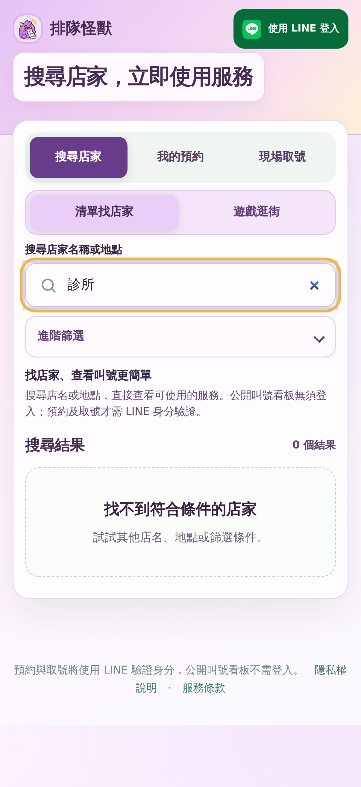</td><td align="center"><b>6. 未登入的「我的預約」顯示 0 筆</b> 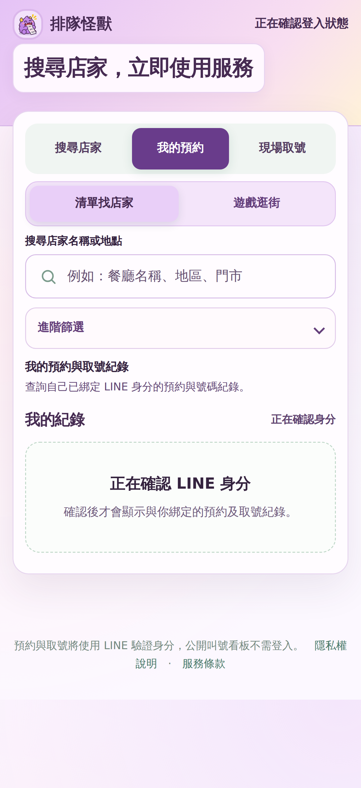</td></tr>
<tr><td align="center"><b>7. 預約入口初始載入</b> </td><td align="center"><b>8. 約 12 秒後跳 LINE Login 錯誤頁</b> 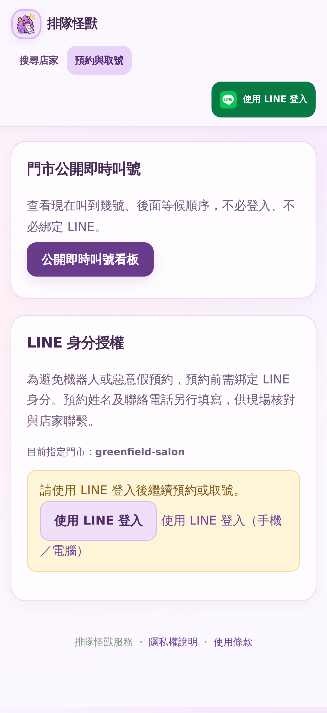</td></tr>
<tr><td align="center"><b>9. 店家登入註冊頁</b> 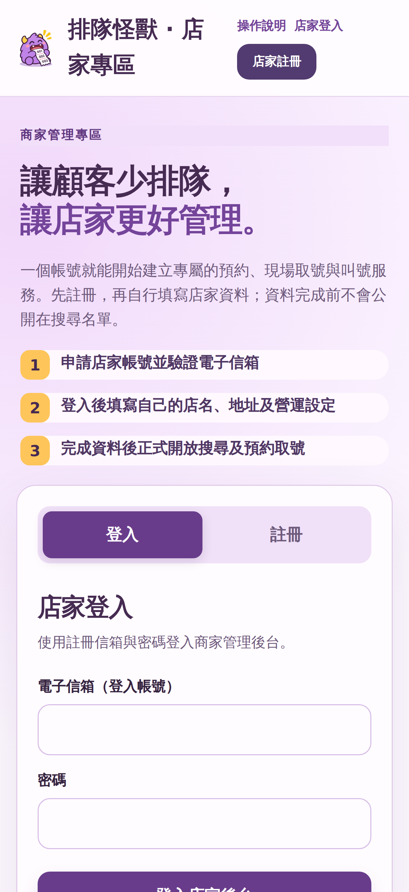</td><td align="center"><b>10. 商家操作指南</b> 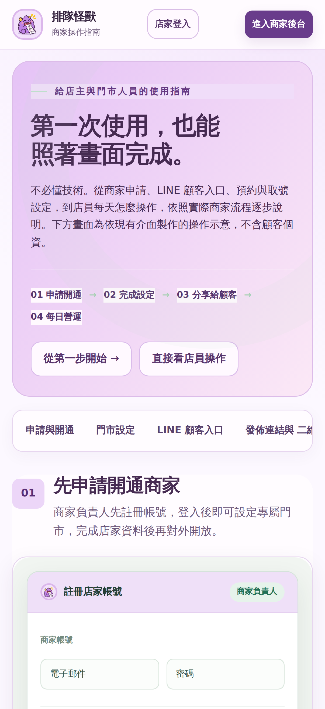</td></tr>
<tr><td align="center"><b>11. 遊戲逛街</b> 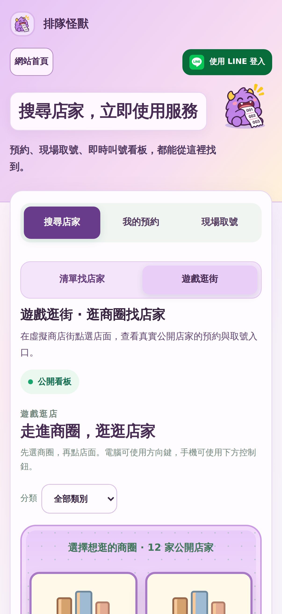</td><td align="center"><b>12. 公開叫號看板</b> 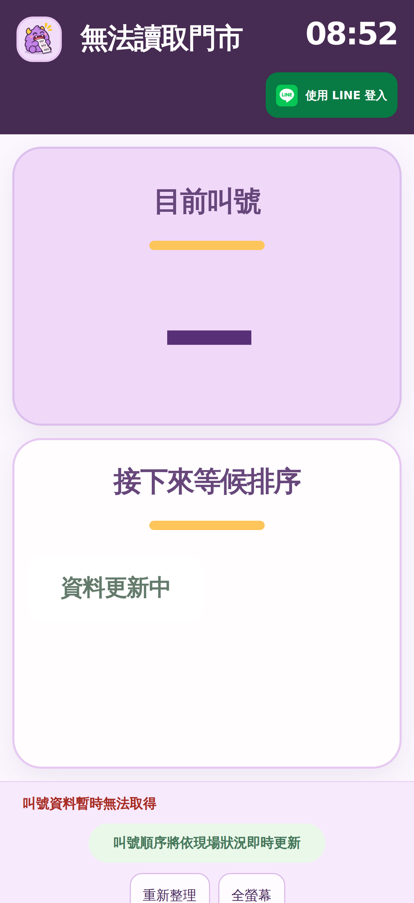</td></tr>
</table>

### 建議優先改進順序

| 優先度 | 問題 | 調整方式 |
|---|---|---|
| P0（驗收阻礙） | 預約 / 取號在一般模擬手機瀏覽器中無法進到表單 | 釐清 LINE Login / LIFF 外部瀏覽器的回跳、錯誤恢復與已安裝 App 深連結；實體 iPhone + LINE 內建瀏覽器做端到端驗收 |
| P1 | 搜尋結果在首屏外、輸入框過低 | 手機版減少頁首和說明，將搜尋框往上移，條件折疊成「篩選」，盡量首屏可見首張店家卡 |
| P1 | 未登入的「我的預約」顯示 0 | 區分「請登入」「載入中」「已登入但沒有紀錄」「查詢失敗」四種狀態 |
| P1 | 商家註冊入口在首頁不明顯 | 在手機選單或底部提供「我是店家・申請使用」，不必影響顧客主入口 |
| P2 | 手機選單重複、商家指南橫向導覽隱藏 | 去重，將導覽改為兩行或明顯顯示可左右滑動 |
| P2 | 點擊區高度太小 | 互動控制至少 44px；放大頁首登入、看板控制、店家頁頂端連結 |
| P2 | 公開頁顯示「測試門市」名稱 | 測試資料保留，但對外可見的示範商家名稱與簡介改成正式、清楚的示範標示；不要硬寫排除條件 |

完整自動化資料： [report.json](./report.json)。本次未登入商家/總部帳號，因此 **不能用這次測試宣稱後台已登入後的表格、編輯流程和權限畫面沒有問題**。
